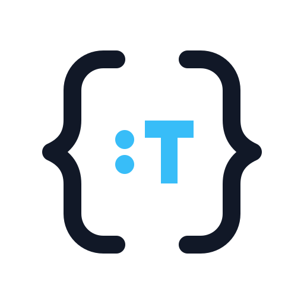

# Typepeek

<p align="center">
  
</p>

Typepeek gives coding agents the TypeScript interface of an installed dependency: exports, signatures, declarations, and public subpaths. It reads the version in your project without importing or executing package code.

## Quick start

Install it alongside the dependencies you want to inspect:

```bash
npm install --save-dev typepeek
npx typepeek overview semver
npx typepeek discover semver version --json
npx typepeek signatures semver parse --json
```

Requires Node.js 24.22.1 or later within the 24.x release line and a `node_modules` installation. Use `--workspace packages/api` for a monorepo package. See the [usage guide](docs/usage.md) for commands and output formats.

## Use with coding agents

Install the agent skill after installing the CLI:

```bash
npx skills@latest add ueberBrot/typepeek --skill typepeek
```

The skill guides the agent from a dependency question to verified signatures.

## Benchmark

In a five-task dependency benchmark, agents using Typepeek and its skill took **21% less time** and used **37% fewer tokens** than agents inspecting files alone.

| Per successful task            | Files only | Typepeek + skill | Saving |
| ------------------------------ | ---------: | ---------------: | -----: |
| Time through the final answer  |     13.4 s |           10.6 s |    21% |
| Reported input + output tokens |      41.3k |            26.0k |    37% |

Means cover the same 112 successful pairs from 240 attempts with four models. Savings vary by task. [Task matrix, timing breakdown, and reproduction](benchmarks/README.md).

## Documentation

- [Usage guide](docs/usage.md): commands, workspaces, pagination, members, and protocol access.
- [Contributing](CONTRIBUTING.md): local setup and checks.
